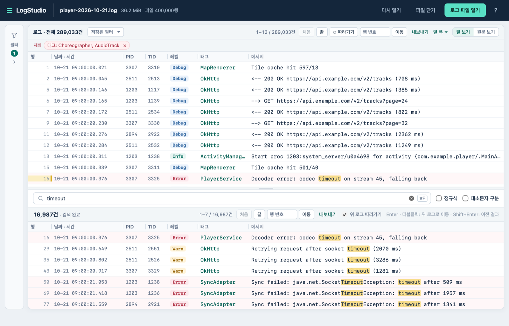

# LogStudio

수 GiB 크기의 Android·iOS 로그와 COVESA DLT 파일을 바로 열어 필터링하고 검색하는 데스크톱 로그 뷰어입니다.

[Windows x64 다운로드](https://github.com/yhwanp/LogStudio/releases/latest) · [macOS 빌드 방법](#macos) · [사용 설명서](docs/USER_GUIDE.md)

https://github.com/user-attachments/assets/bfe612d8-acb8-45b8-8507-1085cf5f9e58

<picture>
  <source media="(prefers-color-scheme: dark)" srcset="docs/images/main-dark.png">
  
</picture>

위쪽에는 필터를 적용한 로그를, 아래쪽에는 그 범위에서 찾은 검색 결과를 함께 보여 줍니다.

> **English:** LogStudio is a desktop log viewer for multi-GB Android logcat, iOS, and COVESA DLT files. The UI and documentation are in Korean. Prebuilt Windows x64 binaries are available on [Releases](https://github.com/yhwanp/LogStudio/releases/latest); on macOS, build from source.

## 주요 기능

- **대용량 파일 즉시 열기:** 최대 8 GiB(UTF-8) 파일을 끝까지 읽을 때까지 기다리지 않고 첫 행부터 바로 보여 줍니다. 손상된 UTF-8 바이트가 섞여 있어도 행을 버리지 않고 해당 구간만 표시합니다.
- **Android·iOS 로그 파싱:** Android `logcat`(`threadtime`·`time`·`brief`, `-v uid`·`year`·`usec`·`nsec`), Android Studio Logcat 복사본, iOS 로그를 날짜·시간·PID·TID·레벨·태그·메시지 열로 나누어 보여 줍니다. 형식에 맞지 않는 줄은 원문 그대로 표시합니다.
- **DLT 파일 지원:** COVESA DLT(`.dlt`, 버전 1) 파일을 시간·타임스탬프·ECU·APID·CTID·레벨·페이로드 열로 표시합니다. ECU·APID·CTID로 필터링하고 결과를 `.dlt` 원본이나 텍스트(`.txt`)로 내보낼 수 있습니다.
- **조건별 필터와 프리셋:** 레벨, 태그, PID/TID, 시간 범위를 조합한 포함·제외 조건으로 로그를 거릅니다(DLT Viewer의 포함·제외 필터와 동일한 방식). 자주 쓰는 필터 조합은 이름을 붙여 저장해 두고 다른 파일에서도 바로 불러올 수 있습니다.
- **빠른 검색:** 문자열 및 정규식(Rust regex) 검색과 대소문자 구분 옵션을 지원합니다. 검색 결과에 일치한 행은 상단 로그에서도 강조 표시됩니다.
- **여러 줄 로그 묶기:** JSON 본문이나 스택 트레이스처럼 여러 줄로 이어진 로그를 앞 로그와 하나로 묶어 필터링하고, 하단 원문 상세에서 전체 내용을 확인합니다.
- **여러 파일 합쳐 열기:** 나뉘어 기록된 로그 파일을 최대 64개까지 로그 시각순으로 이어 하나의 로그처럼 봅니다.
- **실시간 따라가기:** 기록 중인 로그 파일을 `tail -f`처럼 실시간으로 이어서 읽습니다.
- **Android 기기 로그:** 연결한 Android 기기나 에뮬레이터의 logcat을 터미널 없이 기록하며 봅니다(adb 필요). 연결이 끊겨도 같은 기기가 다시 연결되면 자동으로 이어서 기록하고, 기록한 로그는 원본 그대로 저장합니다.
- **북마크·내보내기·작업 복원:** 원하는 행을 북마크하고, 필터·검색 결과를 원본 바이트와 줄바꿈 그대로 파일로 내보냅니다. 파일을 다시 열면 이전에 적용한 필터·검색·북마크·스크롤 위치를 복원합니다.

세부 동작과 규칙은 [사용 설명서](docs/USER_GUIDE.md)를 참고하세요.

## 지원 환경

| OS | 설치 방법 | 비고 |
| --- | --- | --- |
| Windows 10/11 (x64) | [Releases](https://github.com/yhwanp/LogStudio/releases/latest)에서 ZIP 다운로드 | WebView2 Runtime 필요. CI 자동 테스트·빌드 통과([수동 점검 목록](docs/LARGE_LOG_VALIDATION.md#windows-수동-점검)) |
| macOS 12 이상 (Apple Silicon) | 소스에서 직접 빌드 | 자동 테스트 및 실제 앱 화면 검증 완료(Intel Mac 및 하위 버전 미검증) |
| Linux | 배포하지 않음 | 빌드·동작 미검증 |

## 설치 및 실행

### Windows

1. [Releases](https://github.com/yhwanp/LogStudio/releases/latest)에서 `LogStudio-<버전>-windows-x64.zip`을 다운로드합니다(함께 첨부된 `.zip.sha256`으로 체크섬 확인 가능).
2. 압축을 풀고 `LogStudio.exe`를 실행합니다.

- [Microsoft WebView2 Runtime](https://developer.microsoft.com/microsoft-edge/webview2/)이 필요합니다(Windows 11 및 최신 Windows 10에는 기본 설치되어 있음).
- 코드 서명 인증서가 적용되어 있지 않아 실행 시 Windows SmartScreen 경고가 나타날 수 있습니다.

### macOS

GitHub Actions에서는 Windows 빌드만 생성하므로 macOS에서는 소스를 직접 빌드합니다. [rustup](https://rustup.rs)으로 설치한 Rust, Xcode Command Line Tools, Python 3.9 이상이 필요합니다.

```sh
git clone https://github.com/yhwanp/LogStudio.git
cd LogStudio
rustup toolchain install
sh build-run-macos.command
```

`rustup toolchain install`은 `rust-toolchain.toml`에 지정된 Rust 1.99.0과 `rustfmt`·`clippy`를 설치합니다. 빌드가 끝나면 `artifacts/desktop/LogStudio-local.app`이 생성되고 바로 실행됩니다. 스크립트의 상세 동작은 [DEVELOPMENT.md](docs/DEVELOPMENT.md#macos에서-한-번에-빌드하고-실행)를, 다른 Mac에서 옮겨 온 앱이 Gatekeeper에 차단될 때는 [Apple 지원 안내](https://support.apple.com/102445)를 참고하세요.

### 명령줄로 열기

실행 파일 인자로 로그 파일 경로를 넘기면 해당 파일을 바로 열고, 여러 경로를 넘기면 인자 순서대로 합쳐서 엽니다. Windows의 `연결 프로그램`으로 지정하거나 실행 파일 아이콘에 로그 파일을 끌어다 놓아도 됩니다.

```bat
LogStudio.exe C:\logs\main.log.1 C:\logs\main.log
```

```sh
artifacts/desktop/LogStudio-local.app/Contents/MacOS/logstudio-desktop /absolute/path/main.log
```

- `--large-log <경로>` 옵션도 동일하게 동작하며 여러 번 지정할 수 있습니다.

## 기본 사용법

1. 로그 파일을 창에 끌어다 놓거나 `Cmd/Ctrl+O`로 엽니다. 빈 화면의 `샘플 로그 보기`로 먼저 체험해 볼 수도 있습니다.
2. 왼쪽 사이드바의 `필터`를 열어 레벨·태그·PID/TID·시간 조건을 설정하면 상단 로그에 즉시 반영됩니다.
3. `Cmd/Ctrl+F`로 검색어를 입력하면 하단에 결과가 나타나고, `Enter`/`Shift+Enter`로 다음·이전 결과로 이동합니다.
4. 행을 클릭하면 하단 원문 상세 창에 해당 로그의 전체 원문이 표시됩니다. 행을 우클릭하면 그 행의 태그·PID로 필터 조건을 바로 추가하거나 제외할 수 있습니다.
5. `Cmd/Ctrl+B`로 북마크를 토글하고, `내보내기`로 현재 필터·검색 결과를 파일로 저장합니다.

단축키 전체 목록은 앱 상단 바의 `?` 버튼을 누르거나 입력란 밖에서 `?` 키를 누르면 볼 수 있습니다([단축키 안내](docs/USER_GUIDE.md#단축키)).

## 제약 사항

- **열 수 없는 파일:** 8 GiB 초과 파일, 1 MiB를 넘는 행이 포함된 파일, 심볼릭 링크, 일반 바이너리 파일(NUL 포함), UTF-16 텍스트 파일, 압축 파일(`.zip`, `.gz` 등), 스토리지 헤더가 없는 DLT 파일 및 DLT 버전 2 파일
- **DLT 기능 제한:** 실시간 따라가기, 텍스트 로그와의 병합 열기, FIBEX 해석은 지원하지 않습니다.
- **기타 미지원 기능:** ADB 직접 연결, 멀티라인 로그 접기/펼치기, 정규식의 전후방 탐색(lookaround) 및 역참조(backreference)
- 대용량 로그 성능 측정 조건과 미검증 범위는 [LARGE_LOG_VALIDATION.md](docs/LARGE_LOG_VALIDATION.md)에 정리되어 있습니다.

## 개발

Tauri 기반 데스크톱 앱입니다. 화면(`dist/`)은 번들러 없는 ES 모듈로 작성되어 실행 파일에 내장되며, 파일 읽기·파싱·검색은 Rust 코어(`core/`)가 담당합니다. 빌드된 앱은 Python이나 Node.js 없이 단독으로 실행됩니다.

`rust-toolchain.toml`(Rust 1.99.0)과 `Cargo.lock`으로 의존성 버전을 고정합니다. 빌드에 필요한 시스템 도구는 [Tauri 사전 준비 문서](https://v2.tauri.app/start/prerequisites/)를 참고하세요. Node.js 22 이상은 프론트엔드 테스트에, Python 3은 패키징 및 테스트 스크립트에 사용됩니다.

```sh
cargo test --locked --workspace
cargo build --locked --release -p logstudio-desktop
node --test tests/*.test.mjs
python3 desktop/package_macos.py --binary target/release/logstudio-desktop --output artifacts/desktop/LogStudio.app
```

`cargo test`는 약 4분 정도 걸립니다. 패키징 스크립트는 기존 출력 폴더가 있으면 덮어쓰지 않고 중단하므로, 다시 패키징할 때는 기존 `.app`을 삭제하거나 다른 `--output` 경로를 지정하세요. 자세한 아키텍처와 전체 검사 명령은 [DEVELOPMENT.md](docs/DEVELOPMENT.md)에 있습니다.

## 문서

| 문서 | 내용 |
| --- | --- |
| [USER_GUIDE.md](docs/USER_GUIDE.md) | 기능별 동작과 세부 규칙 |
| [DEVELOPMENT.md](docs/DEVELOPMENT.md) | 코드 구조, 엔진 설계, IPC 프로토콜, 빌드·배포·테스트 |
| [LARGE_LOG_VALIDATION.md](docs/LARGE_LOG_VALIDATION.md) | 대용량 로그 성능 측정 결과와 미검증 범위 |
| [SECURITY.md](SECURITY.md) | 보안 취약점 신고 안내 |

## 라이선스

[MIT 라이선스](LICENSE)로 배포합니다. 테스트 전용 픽스처인 `tests/fixtures/covesa/`의 COVESA DLT 샘플은 [MPL-2.0](tests/fixtures/covesa/README.md#라이선스)을 따르며, 배포물에 포함되는 오픈소스 고지는 [THIRD_PARTY_NOTICES.md](desktop/THIRD_PARTY_NOTICES.md)에 있습니다.
